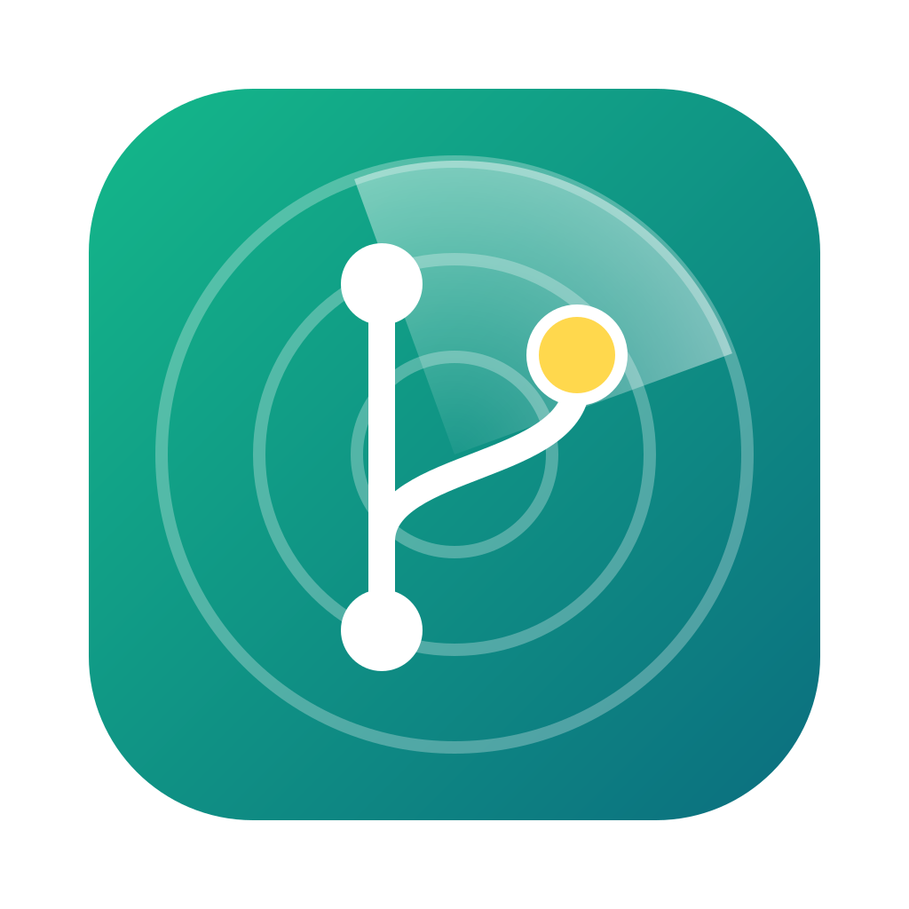
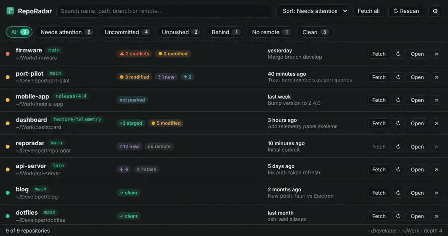
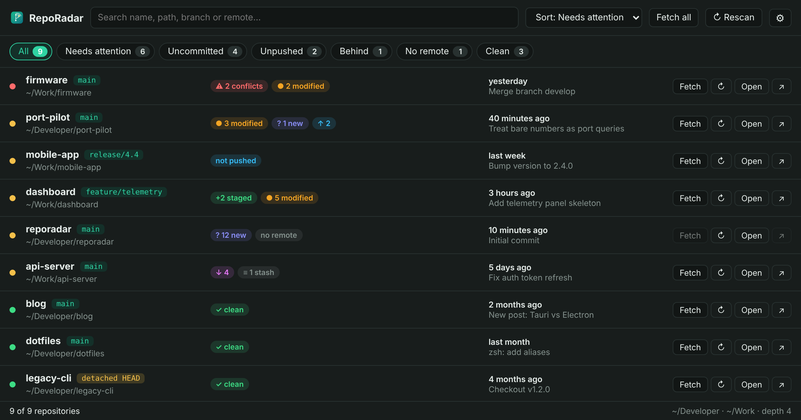
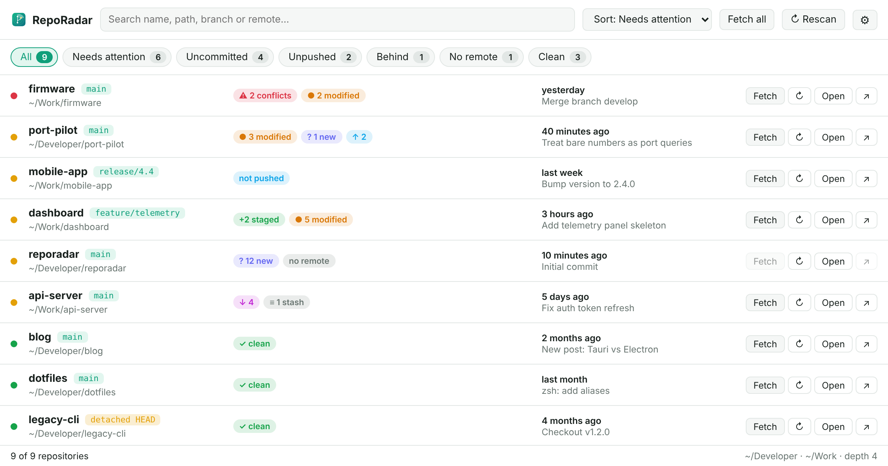
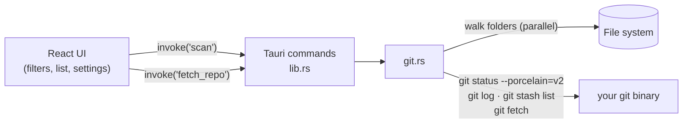

<div align="center">



# RepoRadar

**All your git repositories at a glance.**

Find uncommitted changes, unpushed commits and branches that are behind, across every project on your machine, in one window.
Built with [Tauri 2](https://tauri.app), Rust and React.

[](https://github.com/mypiroglu/repo-radar/releases/latest)
[](https://github.com/mypiroglu/repo-radar/releases)
[](https://github.com/mypiroglu/repo-radar/actions/workflows/ci.yml)
[](LICENSE)


[**Download**](https://github.com/mypiroglu/repo-radar/releases/latest) · [Features](#-features) · [Usage](#-usage) · [Build from source](#-build-from-source) · [Contributing](#-contributing)



</div>

---

## Why?

You have dozens of projects. Some have work you never committed, some have commits you never pushed,
and some are behind what your teammates pushed last week. You only find out when it hurts:
the laptop dies, you switch machines, or you start coding on an outdated branch.

The usual check is a loop of `cd` and `git status` in every folder. RepoRadar does it for all of them at once
and puts the repos that need you at the top.

## ✨ Features

| | |
|---|---|
| 🛰 **Auto discovery** | Scans the folders you choose (default: `~/Developer`, `~/Projects`, `~/code`, `~/Documents`, …) and finds every git repo. |
| 🚦 **Status at a glance** | Staged, modified and untracked files, commits ahead/behind, conflicts, stashes and branch for every repo. |
| 🔥 **Needs attention first** | Repos are sorted by urgency: conflicts, then unpushed work, then uncommitted changes, then behind. |
| 🧮 **Smart filters** | *Needs attention · Uncommitted · Unpushed · Behind · No remote · Clean*, each with a live count. |
| ⬇️ **Fetch all** | `git fetch` every repo in parallel to see what's new on the remote, without touching your working tree. |
| 🔗 **Quick actions** | Open the folder in Finder/Explorer, or open the repo on GitHub/GitLab/Bitbucket in your browser. |
| 🔄 **Always fresh** | Rescans automatically when you switch back to the window. |
| 🛡 **Safe by design** | Read-only: RepoRadar never commits, pulls, pushes or modifies files. Status checks never take git's index lock. |
| 🪶 **Lightweight** | Native Rust backend that uses your own `git`. Small installers, no Electron. |

<table>
  <tr>
    <td></td>
    <td></td>
  </tr>
</table>

## 📦 Installation

Download the installer for your platform from the
[**latest release**](https://github.com/mypiroglu/repo-radar/releases/latest):

| Platform | File |
|---|---|
| macOS (Apple Silicon) | `RepoRadar_x.y.z_aarch64.dmg` |
| macOS (Intel) | `RepoRadar_x.y.z_x64.dmg` |
| Windows | `RepoRadar_x.y.z_x64-setup.exe` or `.msi` |
| Linux | `.AppImage`, `.deb` or `.rpm` |

**Requirement:** `git` must be installed (on macOS: `xcode-select --install` or `brew install git`).

> **macOS note:** builds are not notarized yet. If macOS blocks the app on first launch, open
> **System Settings → Privacy & Security** and click **Open Anyway**, or run:
>
> ```bash
> xattr -dr com.apple.quarantine /Applications/RepoRadar.app
> ```

## 🚀 Usage

### First run

RepoRadar looks for common code folders in your home directory and scans them.
Click **⚙** to add or remove folders and to change the **search depth** (how many folder levels deep to look).

These folders are skipped automatically to keep scans fast: hidden folders, `node_modules`, `target`, `vendor`,
`build`, `dist`, `out`, `Pods`, `DerivedData`, `venv`, `__pycache__`, `Library`.
Repositories inside other repositories (submodules, vendored repos) are not listed separately.

### Reading a row

| Indicator | Meaning |
|---|---|
| 🟢 / 🟡 / 🔴 dot | Clean / needs attention / conflict or error |
| `main` | Current branch (`detached HEAD` when no branch is checked out) |
| **+2 staged** | Files added to the index, ready to commit |
| **● 5 modified** | Tracked files changed but not staged |
| **? 3 new** | Untracked files |
| **↑ 2** | Local commits not pushed to the upstream branch |
| **↓ 4** | Commits on the remote you haven't pulled (run **Fetch** to update) |
| **not pushed** | The branch has never been pushed (no upstream) |
| **no remote** | The repo has no remote at all, so it exists only on this machine |
| **≡ 1 stash** | Stash entries you may have forgotten |
| **⚠ 2 conflicts** | Unresolved merge conflicts |

### Filters and sorting

| Filter | Shows repos that… |
|---|---|
| **Needs attention** | have conflicts, uncommitted changes, unpushed commits or are behind |
| **Uncommitted** | have staged, modified, untracked or conflicted files |
| **Unpushed** | have commits ahead of upstream, or a branch that was never pushed |
| **Behind** | have commits to pull (after a fetch) |
| **No remote** | exist only locally, so they have no backup |
| **Clean** | are fully committed, pushed and up to date |

Sort by **Needs attention** (default), **Recent commit** or **Name**. The search box matches repo name, path,
branch and remote URL.

### Actions

| Button | What it does |
|---|---|
| **Fetch** | `git fetch --all --prune` for that repo (45 s timeout, never prompts for credentials) |
| **Fetch all** | Fetches every repo that has a remote, 4 at a time |
| **↻** | Re-reads that repo's status |
| **Open** | Shows the folder in Finder / Explorer |
| **↗** | Opens the remote in your browser (credentials in remote URLs are stripped) |

### Keyboard shortcuts

| Shortcut | Action |
|---|---|
| <kbd>⌘</kbd>/<kbd>Ctrl</kbd> + <kbd>F</kbd> | Focus search |
| <kbd>⌘</kbd>/<kbd>Ctrl</kbd> + <kbd>R</kbd> | Rescan |
| <kbd>Esc</kbd> | Clear search / close settings |

## 🧠 How it works



1. **Discovery:** folders are walked in parallel ([rayon](https://crates.io/crates/rayon)). Any folder containing
   `.git` is a repo; RepoRadar doesn't descend further into it.
2. **Status:** for each repo, in parallel, RepoRadar runs `git status --porcelain=v2 --branch`, which reports
   branch, upstream, ahead/behind and every changed file in one stable, machine-readable call. It then reads
   the last commit (`git log -1`), stash count and remote URL.
3. **No side effects:** every read runs with `GIT_OPTIONAL_LOCKS=0`, so RepoRadar never takes the index lock
   and never fights with your editor or terminal. Fetches run with `GIT_TERMINAL_PROMPT=0` so they can't hang
   waiting for a password.
4. **Uses your git:** shelling out to the real `git` (instead of re-implementing it) means your config,
   credential helpers, `safe.directory` and `fsmonitor` settings are all honoured.

## 🛠 Build from source

### Prerequisites

- [Node.js](https://nodejs.org) 20+
- [Rust](https://rustup.rs) (stable)
- Tauri's [system dependencies](https://tauri.app/start/prerequisites/) for your OS
- `git`

### Commands

```bash
git clone https://github.com/mypiroglu/repo-radar.git
cd repo-radar
npm install

npm run tauri dev       # run with hot reload
npm run tauri build     # build installers into src-tauri/target/release/bundle
```

### Tests

```bash
cd src-tauri
cargo test
```

The tests build real repositories in a temp folder (bare origin, clone, unpushed commit, stash, staged,
modified and untracked files, a second clone that pushes) and check discovery, status parsing, fetch,
ahead/behind, URL handling and that no index lock is left behind.

### Project structure

```
repo-radar/
├── src/                     # React + TypeScript frontend
│   ├── App.tsx              # toolbar, filters, repo list, settings dialog
│   ├── repo.ts              # filters, attention score, sorting, relative time
│   ├── api.ts               # typed wrappers around Tauri commands
│   └── App.css              # styles (light/dark)
├── src-tauri/               # Rust backend
│   ├── src/git.rs           # discovery, git status parsing, fetch, remote URLs
│   ├── src/lib.rs           # Tauri commands
│   ├── capabilities/        # Tauri permissions (dialog, opener)
│   └── tauri.conf.json      # window, bundle and security (CSP) settings
├── docs/                    # logo, screenshots, demo GIF
└── .github/workflows/       # CI (build + test) and Release (installers)
```

### Releasing

The version lives in `package.json`. To publish a new version:

```bash
npm version patch          # 0.1.0 → 0.1.1 (or: minor / major); creates a commit and tag
git push --follow-tags     # the tag triggers the Release workflow
```

GitHub Actions builds installers for macOS (Apple Silicon and Intel), Windows and Linux and publishes them
on the [Releases](https://github.com/mypiroglu/repo-radar/releases) page.

## ❓ FAQ

<details>
<summary><b>Does RepoRadar change my repositories?</b></summary>

No. It only reads status. The single network operation is **Fetch**, which updates remote-tracking branches
(`origin/main`, …) and never touches your working tree or local branches.
</details>

<details>
<summary><b>"Behind" shows 0 but I know there are new commits.</b></summary>

Git only knows about remote commits after a fetch. Click **Fetch** on the repo or **Fetch all**.
</details>

<details>
<summary><b>A repository is missing.</b></summary>

Check that its parent folder is in **⚙ Folders to scan**, and increase **Search depth** if it is nested deeply.
Repos inside hidden folders or inside other repos are skipped on purpose.
</details>

<details>
<summary><b>Fetch fails for a private repo.</b></summary>

RepoRadar uses your normal git credentials (SSH keys, credential helper, keychain) but never shows a password
prompt. Make sure `git fetch` works in a terminal without asking for a password.
</details>

<details>
<summary><b>Does it send any data anywhere?</b></summary>

No. Apart from `git fetch` to your own remotes, RepoRadar makes no network requests.
</details>

## 🗺 Roadmap

- [ ] Menu bar / tray mode with a badge for repos that need attention
- [ ] Open repo in your editor or terminal
- [ ] Pull (fast-forward only) and push from the list
- [ ] Group by folder / organisation
- [ ] Per-repo ignore list
- [ ] Periodic background fetch
- [ ] Code signing and notarization for macOS

Ideas and feedback are welcome in [Issues](https://github.com/mypiroglu/repo-radar/issues).

## 🤝 Contributing

Contributions are very welcome! See [CONTRIBUTING.md](CONTRIBUTING.md).

## 📄 License

[MIT](LICENSE) © 2026 Muhammet Yusuf Piroglu

---

<sub>Also by the same author: [PortPilot](https://github.com/mypiroglu/port-pilot) – see which process is using a port and free it with one click.</sub>
